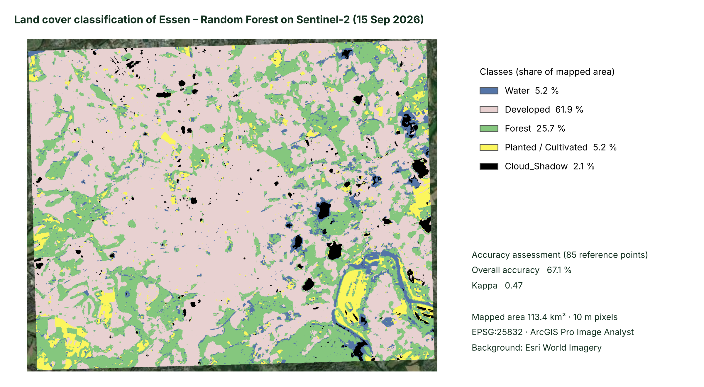

# Random-Forest-Landcover-Essen



**Language / Sprache:** [English](#english) · [Deutsch](#deutsch)

---

## English

### Supervised Land Cover Classification with Random Forest (Sentinel-2, Essen)

A pixel-based **Random Forest (Random Trees)** classification of a Sentinel-2 scene (15 Sep 2026) covering the city of Essen, Germany, built in **ArcGIS Pro (Image Analyst)**. The result is checked with a real **accuracy assessment** (confusion matrix, overall accuracy, Kappa) computed in ArcGIS Pro from 85 reference points.

### Results

| Metric | Value |
|---|---|
| Overall accuracy | **67.1 %** (57 of 85 points) |
| Kappa | **0.47** |
| 95 % interval of overall accuracy (simple approximation) | about ±10 percentage points |
| Mapped area | 113.4 km² (1,134,070 pixels of 10 m × 10 m) |

**Area per class** (`results/area_per_class.csv`, from the raster attribute table computed in ArcGIS Pro)

| Class | Code | Area (km²) | Share |
|---|---|---|---|
| Water | 10 | 5.90 | 5.2 % |
| Developed | 20 | 70.16 | 61.9 % |
| Forest | 40 | 29.10 | 25.7 % |
| Planted / Cultivated | 80 | 5.87 | 5.2 % |
| Cloud_Shadow | 99 | 2.38 | 2.1 % |

**Accuracy per class** (rows = map, columns = reference; `results/confusion_matrix_final.csv`)

| Map \ Reference | Water | Developed | Forest | Planted | Cloud_Shadow | Total | User's acc. |
|---|---|---|---|---|---|---|---|
| Water | 1 | 0 | 1 | 2 | 1 | 5 | 0.20 |
| Developed | 0 | 36 | 9 | 4 | 0 | 49 | 0.73 |
| Forest | 0 | 3 | 14 | 4 | 0 | 21 | 0.67 |
| Planted / Cultivated | 0 | 1 | 0 | 4 | 0 | 5 | 0.80 |
| Cloud_Shadow | 0 | 3 | 0 | 0 | 2 | 5 | 0.40 |
| **Total** | 1 | 43 | 24 | 14 | 3 | 85 | |
| **Producer's acc.** | 1.00 | 0.84 | 0.58 | 0.29 | 0.67 | | OA 0.671 |

**Reading the result**
- Developed areas are mapped best (producer's accuracy 0.84).
- Forest is often confused with Developed (9 of 24 reference forest points): single trees and gardens inside residential areas are mixed pixels at 10 m.
- Planted / Cultivated (lawns, small gardens, fields) has the lowest producer's accuracy (0.29, 4 of 14).
- Water has only **1** reference point, so no reliable statement can be made about it.
- Cloud_Shadow is a technical class for clouds and their shadows in the scene. Three of the five points mapped as Cloud_Shadow are very bright roofs (industrial buildings) and not clouds or shadows.

### Two versions of the accuracy assessment

| Version | Reference labels | Overall accuracy | Kappa |
|---|---|---|---|
| Initial (`confusion_matrix_initial.csv`) | Visual interpretation of Esri World Imagery only | 64.7 % | 0.43 |
| **Final** (`confusion_matrix_final.csv`) | Additionally checked against the Sentinel-2 scene itself | **67.1 %** | **0.47** |

World Imagery shows a different date than the classified scene, so clouds and cloud shadows are not visible there. After checking the points on the Sentinel-2 scene, three labels were changed to Cloud_Shadow (points 36, 66, 75). All 85 points were looked at on the scene overview; only the points mapped as Cloud_Shadow and the points on or next to visible clouds and shadows were inspected one by one. Both versions are kept for transparency.

### Workflow

1. **Data:** Sentinel-2 (Esri Living Atlas "Sentinel-2 Views"), three tiles of 15 Sep 2026, mosaicked. Exported with all **13 bands**, 16-bit, **EPSG:25832** (UTM 32N, ETRS89), cell size 10 m. Extent (EPSG:25832): 355,972 / 5,697,644 to 367,859 / 5,707,169.
2. **Training samples:** 31 polygons drawn in the Classification Wizard (Water 6, Forest 9, Developed 8, Planted / Cultivated 5, Cloud_Shadow 3).
3. **Classifier:** Image Analyst Classification Wizard, supervised, pixel based, **Random Trees**: 50 trees, maximum depth 30, maximum 1000 samples per class.
4. **Accuracy assessment:** *Create Accuracy Assessment Points* (85 points, stratified random, field `Classified`), reference class entered manually in `GrndTruth`, then *Compute Confusion Matrix*.
5. **Export:** classified raster as 8-bit GeoTIFF (NoData 255), maps as PNG (Share → Export Map).

A first attempt with only the three visible bands (RGB) confused dark forest, water and shadows. Using all 13 bands, including near and shortwave infrared, improved the result clearly.

### Limitations

- Reference labels come from **one analyst** using visual interpretation; there is no independent field data.
- **Small sample (n = 85):** wide confidence intervals; the small classes (Water: 1 reference point, Cloud_Shadow: 3) cannot be assessed reliably.
- The number of points per class follows the mapped class shares, so large classes dominate the overall accuracy.
- The training polygons were not held back for validation; the reference points are independent of them.
- **Mixed pixels at 10 m:** urban trees, gardens and lawns are the main source of error.
- **One scene (15 Sep 2026)**, made of three mosaicked tiles with visible brightness seams; no seasonal information.
- Cloud_Shadow is not a land cover class. Pixels under clouds and shadows have no usable land cover information.
- Sentinel-2 source imagery is not redistributed here (size and licence); it can be retrieved from the Living Atlas with the parameters above.

### Repository structure

```
data/      classified GeoTIFF (+ raster attribute table: Value 0-4 -> class code 10/20/40/80/99), accuracy_points.shp
model/     rf_classifier.ecd (Esri classifier definition), essen_schema.ecs (class schema)
maps/      map_overview.png, landcover_rf_essen_map.png, s2_truecolor_map.png
results/   confusion matrices, accuracy per class, area per class, accuracy summary (CSV)
```

Raster values: 0 = Water (10), 1 = Developed (20), 2 = Forest (40), 3 = Planted / Cultivated (80), 4 = Cloud_Shadow (99), 255 = NoData. In `accuracy_points.shp`, `Classified` is the map class and `GrndTruth` the reference class; point number = FID + 1.

---

## Deutsch

### Überwachte Landnutzungsklassifikation mit Random Forest (Sentinel-2, Essen)

Pixelbasierte **Random-Forest-Klassifikation (Random Trees)** einer Sentinel-2-Szene vom 15.09.2026 für das Stadtgebiet Essen, erstellt mit **ArcGIS Pro (Image Analyst)**. Das Ergebnis wird mit einer echten **Genauigkeitsprüfung** (Konfusionsmatrix, Gesamtgenauigkeit, Kappa) aus 85 Referenzpunkten in ArcGIS Pro geprüft.

### Ergebnisse

| Kennzahl | Wert |
|---|---|
| Gesamtgenauigkeit | **67,1 %** (57 von 85 Punkten) |
| Kappa | **0,47** |
| 95-%-Intervall der Gesamtgenauigkeit (einfache Näherung) | etwa ±10 Prozentpunkte |
| Kartierte Fläche | 113,4 km² (1.134.070 Pixel à 10 m × 10 m) |

**Fläche je Klasse** (`results/area_per_class.csv`, aus der Raster-Attributtabelle in ArcGIS Pro)

| Klasse | Code | Fläche (km²) | Anteil |
|---|---|---|---|
| Wasser (Water) | 10 | 5,90 | 5,2 % |
| Bebaut (Developed) | 20 | 70,16 | 61,9 % |
| Wald (Forest) | 40 | 29,10 | 25,7 % |
| Acker/Grünland/Grünflächen (Planted / Cultivated) | 80 | 5,87 | 5,2 % |
| Wolken/Schatten (Cloud_Shadow) | 99 | 2,38 | 2,1 % |

**Genauigkeit je Klasse** (Zeilen = Karte, Spalten = Referenz; `results/confusion_matrix_final.csv`)

| Karte \ Referenz | Wasser | Bebaut | Wald | Planted | Cloud_Shadow | Summe | Nutzergen. |
|---|---|---|---|---|---|---|---|
| Wasser | 1 | 0 | 1 | 2 | 1 | 5 | 0,20 |
| Bebaut | 0 | 36 | 9 | 4 | 0 | 49 | 0,73 |
| Wald | 0 | 3 | 14 | 4 | 0 | 21 | 0,67 |
| Planted / Cultivated | 0 | 1 | 0 | 4 | 0 | 5 | 0,80 |
| Cloud_Shadow | 0 | 3 | 0 | 0 | 2 | 5 | 0,40 |
| **Summe** | 1 | 43 | 24 | 14 | 3 | 85 | |
| **Herstellergen.** | 1,00 | 0,84 | 0,58 | 0,29 | 0,67 | | GG 0,671 |

**Einordnung**
- Bebaute Flächen werden am besten erkannt (Herstellergenauigkeit 0,84).
- Wald wird häufig mit Bebaut verwechselt (9 von 24 Referenzpunkten für Wald): Einzelbäume und Gärten in Wohngebieten sind bei 10 m Mischpixel.
- Planted / Cultivated (Rasen, kleine Gärten, Felder) hat die niedrigste Herstellergenauigkeit (0,29, 4 von 14).
- Für Wasser gibt es nur **1** Referenzpunkt, daher ist keine verlässliche Aussage möglich.
- Cloud_Shadow ist eine technische Klasse für Wolken und deren Schatten in der Szene. Drei der fünf als Cloud_Shadow kartierten Punkte sind sehr helle Dächer (Industriegebäude) und weder Wolken noch Schatten.

### Zwei Versionen der Genauigkeitsprüfung

| Version | Referenzklassen | Gesamtgenauigkeit | Kappa |
|---|---|---|---|
| Initial (`confusion_matrix_initial.csv`) | Nur visuelle Interpretation von Esri World Imagery | 64,7 % | 0,43 |
| **Final** (`confusion_matrix_final.csv`) | Zusätzlich an der Sentinel-2-Szene selbst geprüft | **67,1 %** | **0,47** |

World Imagery zeigt einen anderen Aufnahmezeitpunkt als die klassifizierte Szene, daher sind Wolken und Wolkenschatten dort nicht sichtbar. Nach der Prüfung der Punkte in der Sentinel-2-Szene wurden drei Referenzklassen auf Cloud_Shadow geändert (Punkte 36, 66, 75). Alle 85 Punkte wurden in der Szenenübersicht angesehen; einzeln geprüft wurden nur die als Cloud_Shadow kartierten Punkte sowie Punkte auf oder neben sichtbaren Wolken und Schatten. Beide Versionen bleiben aus Transparenzgründen erhalten.

### Arbeitsablauf

1. **Daten:** Sentinel-2 (Esri Living Atlas „Sentinel-2 Views“), drei Kacheln vom 15.09.2026, zusammengesetzt. Export mit allen **13 Bändern**, 16 Bit, **EPSG:25832** (UTM 32N, ETRS89), Zellgröße 10 m. Ausdehnung (EPSG:25832): 355.972 / 5.697.644 bis 367.859 / 5.707.169.
2. **Trainingsflächen:** 31 Polygone im Classification Wizard (Wasser 6, Wald 9, Bebaut 8, Planted / Cultivated 5, Cloud_Shadow 3).
3. **Klassifikator:** Image-Analyst-Classification-Wizard, überwacht, pixelbasiert, **Random Trees**: 50 Bäume, maximale Tiefe 30, maximal 1000 Samples je Klasse.
4. **Genauigkeitsprüfung:** *Create Accuracy Assessment Points* (85 Punkte, geschichtet zufällig, Feld `Classified`), Referenzklasse manuell in `GrndTruth` eingetragen, danach *Compute Confusion Matrix*.
5. **Export:** Klassifizierter Raster als 8-Bit-GeoTIFF (NoData 255), Karten als PNG (Share → Export Map).

Ein erster Versuch mit nur den drei sichtbaren Bändern (RGB) verwechselte dunklen Wald, Wasser und Schatten. Mit allen 13 Bändern, inklusive nahem und kurzwelligem Infrarot, wurde das Ergebnis deutlich besser.

### Einschränkungen

- Referenzklassen stammen von **einer Person** mit visueller Interpretation; es gibt keine unabhängigen Felddaten.
- **Kleine Stichprobe (n = 85):** große Konfidenzintervalle; die kleinen Klassen (Wasser: 1 Referenzpunkt, Cloud_Shadow: 3) lassen sich nicht verlässlich bewerten.
- Die Punktezahl je Klasse folgt den kartierten Klassenanteilen, daher bestimmen die großen Klassen die Gesamtgenauigkeit.
- Die Trainingspolygone wurden nicht zur Validierung zurückgehalten; die Referenzpunkte sind unabhängig von ihnen.
- **Mischpixel bei 10 m:** Stadtbäume, Gärten und Rasen sind die Hauptfehlerquelle.
- **Eine Szene (15.09.2026)** aus drei zusammengesetzten Kacheln mit sichtbaren Helligkeitsübergängen; keine saisonalen Informationen.
- Cloud_Shadow ist keine Landnutzungsklasse. Unter Wolken und Schatten gibt es keine verwertbare Landnutzungsinformation.
- Die Sentinel-2-Ausgangsdaten werden hier nicht weitergegeben (Größe und Lizenz); sie lassen sich mit den obigen Parametern aus dem Living Atlas abrufen.

### Repository-Struktur

```
data/      klassifizierter GeoTIFF (+ Raster-Attributtabelle: Wert 0-4 -> Klassencode 10/20/40/80/99), accuracy_points.shp
model/     rf_classifier.ecd (Esri-Klassifikatordefinition), essen_schema.ecs (Klassenschema)
maps/      map_overview.png, landcover_rf_essen_map.png, s2_truecolor_map.png
results/   Konfusionsmatrizen, Genauigkeit je Klasse, Fläche je Klasse, Zusammenfassung (CSV)
```

Rasterwerte: 0 = Wasser (10), 1 = Bebaut (20), 2 = Wald (40), 3 = Planted / Cultivated (80), 4 = Cloud_Shadow (99), 255 = NoData. In `accuracy_points.shp` ist `Classified` die Kartenklasse und `GrndTruth` die Referenzklasse; Punktnummer = FID + 1.
